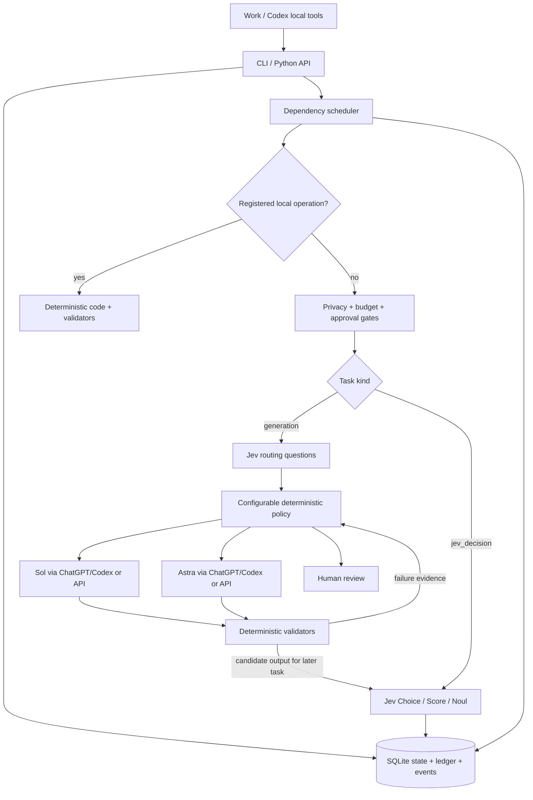

# Architecture

SQLite is the source of truth. Projects store goal, budget, sharing consent, decisions and artifacts. Tasks carry project/workflow/job identities, dependencies, context references, risk, complexity, capabilities, status, routing, token/cost totals, validation and timestamps. `metadata.user` is the importable extension object; other runtime metadata belongs to the engine. Job status is derived from task status, avoiding competing sources of truth.

Events contain compact operational facts. Attempts hold exact request bodies, configured model, provider-reported model/version, output, usage, prices and validation, so prompts can be inspected without flooding standard logs. Jev decision attempts retain typed answers and their probability distributions. The project export includes counts, completed/outstanding work and budgets. Large artifact storage and content-addressed prompt deduplication are future work; context is bounded and only referenced files are read.

Transitions: PENDING → RUNNING → COMPLETED; deterministic failure → FAILED; a generation validation failure returns to PENDING with evidence inside the bounded repair loop. Policy, budget, privacy and external failures → WAITING_FOR_APPROVAL, whose gate kind tells the operator what action is actually needed. Only explicit `approval` gates accept `approve`. Resume rechecks policy and budgets; it does not bypass them.

Each external call writes STARTED before dispatch. API calls also reserve an estimated cost; success settles estimated token cost. ChatGPT-authenticated calls record call counts and known tokens without inventing USD cost or remaining allowance. A known response failure retains reported usage. Unknown outcomes remain unresolved until reconciliation. A crash leaves RUNNING tasks paused on restart. There is intentionally no exactly-once claim for third-party services. A local process lock prevents overlapping runners, and duplicate request fingerprints prevent accidental repeated calls.

Threat boundaries: operator-authored configuration is trusted; project files and provider outputs are data; provider outputs never become shell instructions. Direct API calls only use fixed official HTTPS endpoints, redirects are refused, raw provider error bodies are not logged, secrets come from environment variables, and databases are created with owner-only permissions. ChatGPT execution invokes the installed Codex CLI with a sanitized environment, fixed provider/auth settings, ignored user execution customization, disabled tools and a temporary read-only working directory. It uses existing login state without reading or copying OAuth credentials. This is a personal same-user tool, not a multi-tenant security boundary. Python API users must acquire locks and preserve record invariants.

Jev question packs may be authored statically or loaded from a completed dependency through `questions_from_dependency`. A model-authored pack is JSON data: it is parsed, size-bounded and schema-validated before it reaches the fixed TypeSafe endpoint. It never selects an endpoint, credential, executable capability or side effect.

The core does not search repositories, execute generated code, apply patches, publish, render or send messages. Those require separate capability adapters, validators and explicit execution policy at later milestones.
